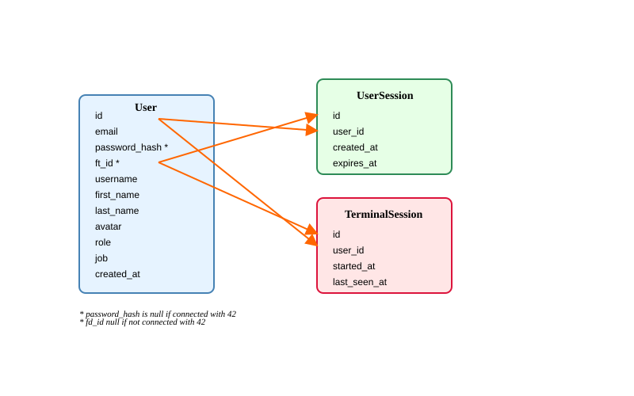

*This project has been created as part of the 42 curriculum by nile-dai, amartel, mmansier, tseche, jdessoli*

## Description

**Silk Space** (ft_silk_space) eases the hiring, promotion and departure of employees inside a company. HR admins run every account from one panel, and each employee gets a ready to use Linux workspace with the tools of their job, opened in the browser. Even a non technical user can give an employee a working environment, change it, or delete it pretty easily.

Key features:
- Sign up and login with an email and a password, or with a 42 account via OAuth.
- Three roles, admins run the company, users work in their workspace, guests wait for an admin to give them a job.
- An admin panel to add, edit and delete accounts, with search, filters, sorting and pages
- One isolated Linux workspace per employee, a Docker container with the tools of their job, and a terminal in the browser. Changing someone's job changes their tools and keeps their files.
- Dashboards with each user's terminal time and workspace memory, and Grafana metrics and alerts for the admins
- Friends, with live online status and friend requests that arrive in real time.
- The whole interface in English, French and Spanish, light and dark themes, and a confirmation for every action

## Instructions

### Prerequisites

- Linux with Docker Engine and the Docker Compose v2 plugin (`docker compose`), rootless Docker with cgroups.
- GNU Make.
- An application registered on the 42 intra for the 42 login.
- Port 6767 free, and an internet access for the first build (Docker images and packages).
- Google Chrome, Chromium or Firefox (see the browsers module).

Everything else (Node, Bun, Python, PostgreSQL, nginx...) runs inside the containers.

### 1. Configuration

The secrets live in three `.env` files. Create them from their examples:

```
cp srcs/.env.example srcs/.env
cp srcs/backend/.env.example srcs/backend/.env
cp srcs/docker/postgres/.env.example srcs/docker/postgres/.env
```

Then fill them in:

| File | Variable | Value |
|---|---|---|
| `srcs/.env` | `GRAFANA_ADMIN_PASSWORD` | Required. Any password, for Grafana's own admin account (nobody logs in with it). |
| `srcs/.env` | `DOCKER_SOCKET` | Rootless Docker only: the path of your Docker socket, given by `docker context inspect --format '{{.Endpoints.docker.Host}}'` without `unix://`, for example `/run/user/12345/docker.sock`. |
| `srcs/backend/.env` | `FT_CLIENT_ID`, `FT_CLIENT_SECRET` | The UID and secret of the 42 application. Its redirect URI must be `https://localhost:6767/api/auth/42/callback`. |
| `srcs/backend/.env` | `SESSION_SECRET` | At least 32 characters, for example the output of `openssl rand -hex 32`. |
| `srcs/backend/.env` | `FRONTEND_URL` | `https://localhost:6767`, the address in the browser, port included. |
| `srcs/backend/.env` | `ADMIN_EMAIL`, `ADMIN_PASSWORD` | Uncomment them: the first admin account, created at startup. Without an admin, nobody can give a job to the new accounts. |
| `srcs/docker/postgres/.env` | `POSTGRES_USER`, `POSTGRES_PASSWORD`, `POSTGRES_DB` | The database credentials. |

### 2. Run

```
make prod
```

It builds the workspace images, then builds and starts the whole stack. Open https://localhost:6767, accept the browser's warning about the self-signed certificate, and login with `ADMIN_EMAIL` and `ADMIN_PASSWORD`.

| Command | What it does |
|---|---|
| `make prod` | Builds the workspace images, then builds and starts the production stack. |
| `make dev` | Starts the development stack: sources mounted, hot reload. |
| `make prod-down`, `make dev-down` | Stops a stack. |
| `make prod-logs`, `make dev-logs` | Follows the logs. |
| `make prod-re`, `make dev-re` | Rebuilds and restarts a stack. |
| `make workspaces` | Builds the workspace images only. |
| `make config` | Checks the compose files of both stacks. |
| `make clean` | Stops both stacks and deletes their volumes, the database included. |
| `make fclean` | `make clean`, and deletes the workspace images. |

## Resources

### On Next.js and the frontend
- https://nextjs.org/docs
- https://peaks.fr/next-js-simplifie-le-developpement-web/
- https://next-intl.dev/
- https://tailwindcss.com/docs
- https://xtermjs.org/

### On Python and FastAPI
- https://www.python.org/
- https://realpython.com/tutorials/databases/
- https://fastapi.tiangolo.com/tutorial/
- https://www.geeksforgeeks.org/python/fastapi-tutorial/
- https://docs.sqlalchemy.org/

### On Docker and monitoring
- https://docs.docker.com/get-started/
- https://docs.docker.com/reference/api/engine/
- https://hub.docker.com/
- https://prometheus.io/docs/
- https://github.com/google/cadvisor
- https://grafana.com/docs/grafana/latest/

### On authentication
- https://datatracker.ietf.org/doc/html/rfc6749 (OAuth 2.0)
- https://api.intra.42.fr/apidoc

### On AI

AI assistants were used as a tool, mostly for debugging errors, or explaining concepts.

- **Research:** explaining APIs and concepts that were new to us, such as the Docker Engine API, cgroups and cAdvisor metrics under rootless Docker.
- **Debugging:** for example finding why the Grafana dashboards stayed empty under rootless Docker (cAdvisor needed the containerd socket and `pid: host`), and why the WebSockets were refused (`FRONTEND_URL` was missing the nginx port).
- **Documentation:** Reviewing and rewriting parts of this README.

## Team information

### Product owner (PO): *jdessoli*

As the product owner for ft_silk_space, *jdessoli* supervised the core project idea, features, and the selection of a coherent technical stack regarding the goal.

### Project manager (PM): *nile-dai*

As the project manager for ft_silk_space, *nile-dai* worked to ensure the completion of the project within a previously set up deadline.

*nile-dai* created a GitHub repository as well as a Discord server.

*jdessoli* and *tseche* also helped with project management: *jdessoli* created a Trello to facilitate work division, and *tseche* helped ensure the communication flow kept running smoothly, so the tools reflected the real state of the project at each stage.

### Tech lead: *mmansier*

As the tech lead, *mmansier* chose the technical stack for both the front and the back end with the team, proposed FastAPI, trained the team on the backend, and performed code review on every part of the project.

*amartel* also took part in the technical choices, he proposed Next.js, trained the team on the frontend, and set up automations to facilitate a proper workflow.

### Developers: the whole team

As the subject asks, every member of the team also worked as a developer:

*nile-dai* mostly worked alongside *amartel* on the frontend side of the project, spending a lot of time on the design choices and implementation.

*amartel* piloted the frontend development.

*mmansier* piloted the backend development.

*tseche* mostly worked alongside *mmansier* on the backend.

*jdessoli* mostly worked on Docker and documentation.

## Project Management

The initial project conception, roles and task distribution were done by *jdessoli*.

The meetings were organized by *nile-dai*. They kept the whole team up to date with the state of each part of the project.

The communication was mostly done through the Discord thanks to *nile-dai*, the Github thanks to *amartel* and *mmansier*, and the updated Trello thanks to *tseche*.

Every change goes through a branch and a pull request on GitHub. Another member reviews and approves it before it reaches `master`, and a GitHub Action checks its commit messages (see the CI/CD module).

## Technical Stack

### Frontend
- **Next.js 16** (App Router, React 19) with **TypeScript**: server components render the pages with the user's data, server actions send the forms.
- **Tailwind CSS v4**, with components from **shadcn/ui** built on **Base UI**, and **lucide** icons.
- **next-intl** for the three languages, **next-themes** for the light and dark themes, **xterm.js** for the terminal, **MDX** for the legal pages.
- **Bun** installs and runs the frontend.

### Backend
- **Python 3.12** and **FastAPI**, served by **uvicorn**.
- **Pydantic** schemas validate every request.
- **SQLAlchemy 2** (ORM) with **psycopg 3**.
- **aiodocker** drives Docker from the backend, **authlib** handles the 42 OAuth flow, **pwdlib** hashes the passwords with Argon2, and **PyJWT** signs the session cookie.

### Database
- **PostgreSQL 15**. Our data is relational (users, their login sessions, their terminal sessions, friend requests between users), and PostgreSQL enforces it in the database itself: foreign keys with `ON DELETE CASCADE`, unique and check constraints, native enum types for the roles and the jobs, and time zone aware dates. It is also widely used in the industry and well supported by SQLAlchemy.

### Infrastructure
- **Docker Compose** runs the stack, and **make** is the single entry point.
- **nginx** is the only exposed service: HTTPS on port 6767 with a certificate generated at build time, reverse proxy to Next.js and FastAPI, WebSocket upgrades, and the access check in front of Grafana.
- **Prometheus**, **cAdvisor** and **Grafana** for the monitoring.
- **GitHub Actions**, **commitlint** and **Husky** for the CI.

### Why these choices
- **Next.js and FastAPI:** the team could split between the front and the back end, each with a framework that gives routing, validation and a clear structure. Both are typed (TypeScript and Pydantic), so the API's shapes are checked on both sides.
- **An asynchronous backend:** FastAPI runs on asyncio, so one process serves the HTTP API, every open terminal and the live events, and talks to Docker, without blocking.
- **Docker containers for the workspaces:** they start in a second, the kernel limits their memory, CPU and processes, and each job is one image built on a common base.
- **nginx in front of everything:** a single HTTPS entry point, so every connection from a browser is encrypted, and the other services are only reachable on the Docker network.

## Database Schema

### Visual representation



### Tables

The tables are created by SQLAlchemy when the backend starts (`srcs/backend/app/db/`).

**`users`**: one row per account.

| Column | Type | Notes |
|---|---|---|
| `id` | integer | Primary key. |
| `email` | varchar | Unique, stored in lowercase. |
| `password_hash` | varchar, nullable | Argon2 hash. Null for the accounts that only login with 42. |
| `ft_id` | integer, nullable | Unique, the id of the linked 42 account. |
| `username` | varchar | Display name, 3 to 20 letters, digits, `_` or `-`. |
| `first_name`, `last_name` | varchar | |
| `avatar` | varchar, nullable | The uploaded picture, as a data URL. Null for the default avatar. |
| `role` | enum `user_role` | `admin`, `user` or `guest`. |
| `job` | enum `user_job`, nullable | `accountant`, `data-analyst`, `devops-engineer`, `software-engineer` or `technical-writer`. Null: no workspace. |
| `created_at` | timestamp with time zone | Set by the database. |

A check constraint (`users_has_login_method`) makes sure every account has a password or a 42 account.

**`sessions`**: one row per logged in browser.

| Column | Type | Notes |
|---|---|---|
| `id` | varchar | Primary key, a random id put in the session cookie (JWT). |
| `user_id` | integer | Foreign key to `users.id`, `ON DELETE CASCADE`, indexed. |
| `created_at` | timestamp with time zone | |
| `expires_at` | timestamp with time zone | |

Every request checks that its row still exists, so a logout or a deleted account ends the session at once, and a password change ends the sessions of the other browsers.

**`terminal_sessions`**: one row per terminal opened, for the log time.

| Column | Type | Notes |
|---|---|---|
| `id` | integer | Primary key. |
| `user_id` | integer | Foreign key to `users.id`, `ON DELETE CASCADE`, indexed. |
| `started_at` | timestamp with time zone | |
| `last_seen_at` | timestamp with time zone | Updated while the terminal is open. |

Rows older than 62 days are deleted.

**`friend_requests`**: one row per friend request.

| Column | Type | Notes |
|---|---|---|
| `user_id` | integer | Who asked. Foreign key to `users.id`, `ON DELETE CASCADE`. |
| `friend_id` | integer | Who was asked. Foreign key to `users.id`, `ON DELETE CASCADE`, indexed. |

The primary key is the pair, so the same request can't be sent twice. Two users who asked each other are friends.

### Relationships

- A user has many `sessions` and many `terminal_sessions` (one to many).
- Users are linked to each other through `friend_requests` (many to many).
- Deleting a user deletes all of their rows, thanks to `ON DELETE CASCADE`.

## Features List

| Feature | Description | Worked on by |
|---|---|---|
| Landing page | Presents Silk Space, with the sign up and login buttons and the language and theme switches. | nile-dai, amartel |
| Sign up and login | Email and password forms, checked in the browser and by the backend. Passwords hashed with Argon2, sessions stored in the database, logout. A new account is a guest until an admin gives it a job. | nile-dai, mmansier, jdessoli |
| 42 login | OAuth 2.0 with the 42 intra. An account created with the same email is linked to the 42 account on its first 42 login. | mmansier, jdessoli |
| Roles | Admin, user and guest, each with their own dashboard. A non admin account is a guest without a job and a user with one. | tseche, mmansier, jdessoli |
| Admin panel | List, create, edit and delete accounts, choose their role and job, with search, filters, sorting and pages. | jdessoli, nile-dai, tseche, mmansier |
| Profile | Change your names, username and password (which logs out your other browsers), and upload or remove your avatar. | jdessoli, mmansier |
| Workspaces | One Docker container per user, from the image of their job. A job change replaces the tools and keeps the files, deleting the account deletes everything. | mmansier, jdessoli, tseche |
| Web terminal | A real shell in the browser with xterm.js, over a WebSocket. Every failure shows a translated explanation. | mmansier, jdessoli |
| User dashboard | Terminal time this week, this month and per day, and the memory used by the workspace. | mmansier, nile-dai |
| Friends | Search users, send, accept, decline and remove friend requests, see who is online. | mmansier |
| Live events | Online status and friend requests pushed to the browser in real time. | mmansier |
| Notifications | A toast confirms every creation, update and deletion, in the user's language. | mmansier, jdessoli |
| Monitoring | Prometheus, cAdvisor and Grafana, with alert rules, and the Grafana dashboard inside the admin dashboard. | tseche, mmansier |
| Languages | English, French and Spanish. | nile-dai, jdessoli |
| Themes | Light, dark, or the system's theme. | nile-dai, amartel |
| Legal pages | Privacy policy and terms of service in the three languages, linked from every footer. | jdessoli |
| Search engines | A title and description on every page, language links, `sitemap.xml` and `robots.txt`. | jdessoli |
| Docker setup | `make prod` and `make dev`, nginx with HTTPS, a development stack with hot reload. | amartel, mmansier, jdessoli |
| CI | Conventional commits checked by commitlint, on the developer's machine and on every pull request. | amartel |

## Modules

| Module | Category | Type | Points |
|---|---|---|---|
| [Use a framework for both the frontend and backend](#major-use-a-framework-for-both-the-frontend-and-backend-2-pts) | Web | Major | 2 |
| [Implement real-time features using WebSockets](#major-implement-real-time-features-using-websockets-2-pts) | Web | Major | 2 |
| [Isolated Linux workspaces with a web terminal](#major-module-of-choice-isolated-linux-workspaces-with-a-web-terminal-2-pts) | Modules of choice | Major | 2 |
| [Standard user management and authentication](#major-standard-user-management-and-authentication-2-pts) | User Management | Major | 2 |
| [Advanced permissions system](#major-advanced-permissions-system-2-pts) | User Management | Major | 2 |
| [Monitoring system with Prometheus and Grafana](#major-monitoring-system-with-prometheus-and-grafana-2-pts) | DevOps | Major | 2 |
| [Use an ORM for the database](#minor-use-an-orm-for-the-database-1-pt) | Web | Minor | 1 |
| [A complete notification system](#minor-a-complete-notification-system-1-pt) | Web | Minor | 1 |
| [Server-Side Rendering (SSR)](#minor-server-side-rendering-1-pt) | Web | Minor | 1 |
| [Custom-made design system with reusable components](#minor-custom-made-design-system-with-reusable-components-1-pt) | Web | Minor | 1 |
| [Advanced search with filters, sorting and pagination](#minor-advanced-search-with-filters-sorting-and-pagination-1-pt) | Web | Minor | 1 |
| [Support for multiple languages](#minor-support-for-multiple-languages-1-pt) | Accessibility and Internationalization | Minor | 1 |
| [Support for additional browsers](#minor-support-for-additional-browsers-1-pt) | Accessibility and Internationalization | Minor | 1 |
| [Remote authentication with OAuth 2.0](#minor-remote-authentication-with-oauth-20-1-pt) | User Management | Minor | 1 |
| [User activity analytics and insights dashboard](#minor-user-activity-analytics-and-insights-dashboard-1-pt) | User Management | Minor | 1 |
| [CI/CD with conventional commits and automated checks](#minor-module-of-choice-cicd-with-conventional-commits-and-automated-checks-1-pt) | Modules of choice | Minor | 1 |
| **Total** | | | **22** |

### Major: Use a framework for both the frontend and backend (2 pts)

*Worked on by:* everyone

**Why:** both frameworks give us routing, validation and a structure every member can follow, so the team could split the work between the front and the back end without reinventing the basics. Next.js renders pages on the server (see the SSR module) and has a clear place for everything. FastAPI checks every request against typed schemas and documents the API by itself.

**How it works:**
- **Frontend: Next.js 16 (React 19)**, in `srcs/frontend`. One folder per page under `app/[locale]/`, server components that read the session and call the backend before sending the page, server actions for the forms (`actions/`), shared components in `components/`.
- **Backend: FastAPI**, in `srcs/backend/app`. One router per domain in `routers/` (`auth`, `oauth42`, `users`, `friends`, `stats`, `workspace`, `websocket`, `events`, `metrics`), pydantic schemas that refuse any invalid or unexpected field (`schemas.py`), and dependencies that require a valid session or the admin role (`security.py`).
- **How they talk:** the browser only talks to nginx, which sends `/api/` to FastAPI and the rest to Next.js. On the server, Next.js calls FastAPI on the Docker network with the user's session cookie (`srcs/frontend/lib/backend.ts`).

### Major: Implement real-time features using WebSockets (2 pts)

*Worked on by:* mmansier

**Why:** in a company tool, people should see who is available right now, and a friend request should reach its receiver without them reloading the page.

**How it works:** every page of the app opens one WebSocket, `/api/ws/events` (`srcs/backend/app/routers/events.py` and `realtime.py`, `srcs/frontend/components/layout/RealtimeProvider.tsx`). The browser only listens, and the server sends JSON events.
- **Real-time updates across clients:**
  - A user is online while at least one of their tabs is connected. When they open their first tab, every connected user receives `online`. When they close their last one, everyone receives `offline`.
  - A tab that connects first receives `presence`, the list of everyone online.
  - Friend requests: the asked user receives `friend_request`, the one who asked receives `friend_accepted` once the request is accepted, and the other user receives `friend_removed` when a friendship ends. The friends page and the online dots update at once, and a toast tells the user.
- **Connection and disconnection handled gracefully:**
  - The server keeps the open tabs of each user, and removes a tab as soon as it closes.
  - When the connection drops, the browser reconnects by itself, waiting longer each time (1 second, then up to 30 seconds), so a restarting backend isn't flooded. Once reconnected, `presence` sends the current state again.
  - The server checks the session every 5 seconds. A logout or a deleted account closes the socket with the code `4401`, and the browser shows a message and goes back to the login page.
- **Efficient broadcasting:** an event is encoded once, then sent to every tab concurrently (`asyncio.gather`). A tab that is closing doesn't block or break the others.
- **Security:** the server only accepts the WebSocket from our own site (the `Origin` header must be `FRONTEND_URL`) and with a valid session cookie.

The workspace terminal also uses a WebSocket. It is described with the workspaces module of choice.

### Major (module of choice): Isolated Linux workspaces with a web terminal (2 pts)

*Worked on by:* jdessoli, mmansier

**Why we chose it:** it is what Silk Space is for. When an HR user gives an employee a job, the employee gets a Linux environment with the tools of that job (software engineer, data analyst, DevOps engineer, accountant or technical writer), which they open in their browser. Changing their job changes their tools and keeps their files and deleting their account deletes everything

**Technical challenges:**
- **Driving Docker from the backend.** FastAPI talks to the Docker API through the Docker socket (aiodocker, `srcs/backend/app/docker/workspace.py`). Each user gets their own container, private network and persistent home volume, created on first use from the image of their job (`srcs/docker/workspaces/`: a common base image and one image per job).
- **Isolation and limits.** The shell runs as a regular user, without any Linux capabilities and unable to gain privileges. Memory (1 GB), CPU (1 core) and number of processes (256) are capped per container, and each user's private network keeps the workspaces apart.
- **Lifecycle.** A job change replaces the container but keeps the home volume, so the files survive. Deleting a user removes their container, network and volume. A broken container is recreated instead of failing forever, and a lock per user stops two requests from creating the same workspace twice.
- **The terminal.** xterm.js in the browser, a WebSocket through nginx to FastAPI, then a bash with a TTY inside the container (`routers/websocket.py`, `components/workspace/`). Keystrokes and output go as raw bytes in both directions, the terminal size follows the window, and closing the page hangs up the shell like a real terminal.
- **Security of the connection.** Only our own site may open the WebSocket, it needs a valid session, and the session is checked again every 5 seconds: a logout or a deleted account closes the open terminals.
- **Every failure explained.** No job yet, image not built, Docker error, session ended, connection lost: each one shows a translated message with a way out (reconnect, login again, back to the dashboard).
- **Log time.** Each terminal session is recorded (`db/terminal_sessions.py`) and feeds the user's statistics.

**Value for the project:** without it, Silk Space would only be a list of users. With it, an HR action has a real effect within seconds: an employee is hired, promoted or leaves, and their working environment follows.

**Why it deserves Major:** it touches every layer of the project (container infrastructure, asynchronous backend, real time browser terminal and security), and is comparable in size to the listed Major modules such as a backend as microservices.

### Major: Standard user management and authentication (2 pts)

*Worked on by:* mmansier, tseche

**Why:** every employee needs a secure account to login, see their dashboard and use their workspace, and a way to find their colleagues.

**How it works:**
- **Authentication:** email and password, or the 42 account (see the OAuth module). Passwords are hashed with Argon2 and never stored in plain text. The session is an `HttpOnly`, `Secure` cookie, backed by a row in the database, so it can be ended from the server.
- **Sign up:** first name, last name, email and password, checked in the browser and again by the backend. The username is generated from the email, and the user can change it from their profile. A new account is a guest until an admin gives it a job.
- **Profile page** (`/profile`): shows the user's information, and lets them change their names and username, their password (the old one is asked again, and their other browsers are logged out), and their avatar.
- **Avatar:** the user picks a PNG, JPEG or WebP picture, which the browser resizes to 256 pixels before sending it. The backend only accepts these three formats and checks the file's first bytes, so a file that only claims to be an image is refused. Without a picture, the avatar shows the user's initials.
- **Friends** (`/friends`): search users by username, send a friend request, accept or decline the received ones, and remove a friend. Each friend shows whether they are online right now (see the WebSockets module).

### Major: Advanced permissions system (2 pts)

*Worked on by:* jdessoli, mmansier, tseche

**Why:** Silk Space is run by HR admins. They create the accounts, give each employee a job (and with it a workspace) and delete the accounts of the people who leave. Employees only see and change their own account.

**Roles:**
- **Admin:** the admin dashboard, with the workspace metrics in Grafana and every account. An admin can create users and other admins, change anyone's names, username, job and role, and delete accounts.
- **User:** their own dashboard and statistics, their workspace, their friends, and their profile, where they can change their names, username and password, but not their job or role.
- **Guest:** an account without a job, after a sign up or a first 42 login. A guest has their profile and friends, and a page that tells them to wait for an admin. They become a user as soon as an admin gives them a job, and a guest again if the job is removed.

**How it works:**
- **Checked by the backend on every request.** Every `/users` route requires the admin role (`require_admin` in `srcs/backend/app/security.py`), and anyone else gets a 403. The role is read from the database each time, so a promotion or a demotion takes effect on the user's next request.
- **One rule for guests and users** (`role_for` in `srcs/backend/app/db/connection.py`): whatever the request asks, a non admin account is stored as a guest without a job and as a user with one.
- **CRUD on users** (`srcs/backend/app/routers/users.py`): list, read, create with a role, edit (names, username, job, role) and delete. Deleting an account also deletes its workspace (container, network and volume) and its sessions, so it is logged out everywhere. If Docker can't remove the workspace, the account is kept and the admin can try again.
- **Always one admin left.** An admin can't remove their own admin role or delete their own account. The signup form and the profile page refuse any role or job sent to them.
- **Different views per role.** The server sends each role to its own dashboard (`/admin`, `/user` or `/guest`) and away from the others. In the admin panel (`srcs/frontend/components/admin/`), admins have an Admin badge in the list, the create and edit forms have a role choice, and every account but the admin's own has a delete button with a confirmation.

### Major: Monitoring system with Prometheus and Grafana (2 pts)

*Worked on by:* tseche, mmansier

**Why:** every employee's workspace uses the company's machine. Admins need to see how much CPU, memory and network each workspace uses, and to be warned when something goes wrong.

**How it works:**
- **Collecting the metrics:** cAdvisor reads the CPU, memory and network use of every container from the kernel, with the containers' Docker labels, so each metric says which user's workspace it comes from. Prometheus scrapes it every 15 seconds (`srcs/docker/prometheus/prometheus.yml`).
- **Dashboards:** Grafana is provisioned from files (`srcs/docker/grafana/provisioning/`): the Prometheus data source and the workspace dashboard, with the CPU, memory, memory percentage, uptime and network traffic of the workspace picked in a list, refreshed every 30 seconds. Admins open it from their dashboard ("Show metrics in Grafana"), or in a new tab.
- **Alerting rules** (`srcs/docker/prometheus/alerts.yml`), listed with their state in Grafana on Alerting > Alert rules:
  - `TargetDown`: Prometheus can't reach cAdvisor, or itself, for 1 minute.
  - `WorkspaceMemoryHigh`: a workspace uses more than 80% of its memory limit for 1 minute.
- **Secure access:** Grafana isn't exposed, only nginx is. For every request to `/grafana/`, nginx asks the backend whether the session belongs to an admin (`auth_request`), and only then passes the request on, with the admin's email in a header that nginx sets itself, so a browser can't pick the account. Grafana's login form is disabled.

**How to check it:** as an admin, open the Grafana dashboard. To see an alert fire, stop the cAdvisor container: `TargetDown` becomes pending, then firing after a minute, and goes back to normal once cAdvisor is started again.

### Minor: Use an ORM for the database (1 pt)

*Worked on by:* tseche

**Why:** the tables are defined once, as typed Python classes, and the queries are written in Python instead of SQL strings: values always travel as parameters, so they can't be used for SQL injection.

**How it works:** SQLAlchemy 2 with PostgreSQL (psycopg). The tables are Python classes in `srcs/backend/app/db/`: users (with a role and a job, and a check that every account has a password or a 42 login), login sessions, terminal sessions and friend requests, linked to users by foreign keys. The queries go through `Session` and `select` in `db/requests.py`, and the tables are created when the backend starts.

### Minor: A complete notification system (1 pt)

*Worked on by:* mmansier

**Why:** every action that creates, changes or deletes something gets a clear confirmation, so nobody wonders whether a click worked.

**How it works:** toasts from the Base UI toast manager (`srcs/frontend/components/ui/toast.tsx`), shown on every page by the `<Toaster />` of the root layout, in the user's language (`Toast` and the forms' texts in `messages/*.json`).
- **Creation:** a new account after signup, and a new user from the admin panel.
- **Update:** the profile, the avatar and the password, and a user edited from the admin panel.
- **Deletion:** a user deleted from the admin panel, an avatar removed from the profile, and a friend removed.
- **Live:** a friend request received, and a request accepted by the other user, while the user is on any page, and a warning when the session ends.
- A toast only appears once the server has confirmed the action. Errors stay next to the field or the form they concern.

### Minor: Server-Side Rendering (1 pt)

*Worked on by:* nile-dai, amartel, jdessoli

**Why:** pages arrive with their content already in the HTML. The dashboards come with the user's data in place, without a loading flash, and a visitor who isn't logged in is sent to the login page straight away. The public pages are fast, and search engines get everything from the HTML: the content, a title and description in the page's language, the same page in the other languages, and the list of public pages.

**How it works:** Next.js server components, and the metadata Next.js puts in each page's `<head>`.
- **Rendering:** the dashboards and the profile, workspace and friends pages read the session cookie on the server, call the backend and render at request time (`getCurrentUser` in `srcs/frontend/lib/backend.ts`). With `cacheComponents`, the static part of these pages is prerendered and the user's part is streamed into it. The landing, signup and legal pages are prerendered at build time in each language (`generateStaticParams`).
- **Titles and descriptions:** every page has its own, in its language (`generateMetadata`, with the texts in `Metadata` in `srcs/frontend/messages/*.json` and `pageMetadata` in `srcs/frontend/lib/metadata.ts`). The root layout gives the site's description and a template that adds the site's name after each title: "login · Silk Space". The language comes from the route (`next/root-params`), not from the request, so the metadata doesn't stop a page from being prerendered.
- **Languages:** each public page (landing, login, signup, legal) has a canonical link to itself and `hreflang` links to the same page in English, French and Spanish. `x-default` points to the address without a language, which sends visitors to their browser's language.
- **Private pages:** the pages behind a login are marked `noindex, nofollow` (the `(app)` layout) and disallowed in `/robots.txt`, in every language.
- **`/sitemap.xml` and `/robots.txt`:** the sitemap lists every public page in every language, with its language links (`srcs/frontend/app/sitemap.ts`), and robots.txt points to it (`srcs/frontend/app/robots.ts`). Both are built at build time.
- The absolute links use `SITE_URL`, read at build time, which defaults to `https://localhost:6767`, where nginx serves the site.

**How to check it:** open F12 in the HTML and check if `<head>` has the page's title, description, canonical and language links. https://localhost:6767/sitemap.xml and https://localhost:6767/robots.txt list the public and private pages.

### Minor: Custom-made design system with reusable components (1 pt)

*Worked on by:* nile-dai, amartel, tseche

**Why:** the same buttons, fields, dialogs and colors on every page make the interface consistent and faster to build, and the accessibility work is done once, in the components.

**How it works:**
- **Components:** 25 reusable components in `srcs/frontend/components/ui/` (buttons, inputs, fields, selects, checkboxes, switches, dialogs, alert dialogs, sheets, drawers, dropdown menus, hover cards, tooltips, cards, badges, avatars, toasts, spinners, the logo...). They started from shadcn/ui, on top of Base UI, and were adapted to Silk Space. Our own components are built on them, such as `FormField`, `CustomBadge` and the role and job pickers.
- **Colors and typography:** the palette, radii and fonts (Geist Sans and Geist Mono) are design tokens, CSS variables in the `@theme` of `srcs/frontend/app/[locale]/globals.css`, with a value for the light theme and one for the dark theme. Tailwind CSS v4 turns them into classes.
- **Icons:** lucide.
- **Themes:** light, dark or the system's theme, from the switch on the landing page and in the user menu. The choice is kept in the browser (next-themes).
- **Accessibility:** the Base UI primitives handle the keyboard navigation and the focus, and every icon button has a translated label for screen readers.

### Minor: Advanced search with filters, sorting and pagination (1 pt)

*Worked on by:* jdessoli, mmansier

**Why:** admins run every account from one list. Search, filters and pages keep it usable as the company grows, and find anyone in a few keystrokes.

**How it works:** in the admin panel (`srcs/frontend/components/admin/`), on the list of accounts the server sends with the page.
- **Search:** username, email, and first and last name in either order, ignoring case and accents ("elodie" finds "Élodie").
- **Filters:** by role and by job, "no workspace" included, from the funnel menu. Each choice shows how many users it would leave given the search and the other filter, and a dot on the funnel shows that a filter is on.
- **Sorting:** by creation date, username or email, ascending or descending.
- **Pagination:** 10 users per page, with the number of results. A new search, filter or sort starts again from the first page.
- The roles come from one list (`ROLES` in `srcs/frontend/types/User.ts`), shared by the role filter and the role picker, so a new role shows up in both.

### Minor: Support for multiple languages (1 pt)

*Worked on by:* nile-dai, jdessoli

**Why:** the team and the first users speak French, English is the default, and Spanish makes the third language.

**How it works:** next-intl, in English, French and Spanish.
- The language is part of the address (`/en`, `/fr`, `/es`, set in `srcs/frontend/i18n/routing.ts`), and visitors arriving on `/` are sent to their browser's language.
- Every text shown to the user, labels read by screen readers and the hints of the form fields included, lives in `srcs/frontend/messages/{en,fr,es}.json`. The backend's English error messages are never shown as they are: the frontend turns them into translated messages.
- The language can be changed from the landing page footer and from the user menu. Dates follow the chosen language.
- The privacy policy and the terms of service are written in each language (`srcs/frontend/content/legal/`), and a page keeps its address from one language to another.

### Minor: Support for additional browsers (1 pt)

*Worked on by:* jdessoli

**Supported browsers:** Google Chrome (required by the subject), Chromium and Firefox, in their current versions. The real minimum comes from Next.js 16 and Tailwind CSS v4: Chrome and Chromium 111+, Firefox 128+.

**How we checked it:** every feature was driven in Chromium by an automated browser pass (landing, login, dashboard menus, admin dialogs, and the terminal against a stand-in shell), and the same features were checked by hand in each browser.

**What it fixed:**
- The light theme used each browser's default font (a broken `--font-sans` variable), so the pages looked different from one browser to another. It now uses Geist Sans everywhere.
- A failed login emptied the email and password fields.

**Known limitations:**
- The HTTPS certificate is self-signed, so each browser shows its own warning on the first visit. Chrome and Chromium: Advanced → Proceed to localhost. Firefox: Advanced → Accept the Risk and Continue.
- In the terminal, the shortcuts browsers keep for themselves (Ctrl+W, Ctrl+T, Ctrl+N, Ctrl+Tab) act on the browser tabs and never reach the shell.

### Minor: Remote authentication with OAuth 2.0 (1 pt)

*Worked on by:* mmansier

**Why:** employees login with the 42 account they already have, with no new password to create and remember. 42 vouches for the email address, so an account an admin created with that email is linked to the 42 account on its first 42 login.

**How it works:** the OAuth 2.0 authorization code flow, in `srcs/backend/app/routers/oauth42.py` with the authlib library.

1. "login with 42" opens `/api/auth/42/login`. The backend redirects the browser to the 42 intra with our `client_id`, the `redirect_uri`, `scope=public` and a random `state`, which it also keeps in a signed `oauth_state` cookie for 10 minutes.
2. The user accepts on the intra, which sends the browser back to `/api/auth/42/callback` with a `code` and the same `state`.
3. The backend checks that the `state` matches the cookie, so a login this browser didn't start is refused (CSRF protection). It then trades the `code` and our client secret for an access token, server to server: the secret never reaches the browser.
4. With that token it reads the profile from `/v2/me` (id, login, email, names), then drops the token. Nothing from 42 is stored besides those fields. The 42 picture isn't used: 42's CDN only serves it with a token, so a browser can't load it.
5. It finds the account: the one with the same 42 id, or else the one with the same email, or else a new guest account with no job, so no workspace until an admin assigns one. An account found by its email is now linked to this 42 account: its password is removed and every browser logged in to it is logged out, because 42 has proven that the email belongs to this person while anyone can sign up with any email. From then on, it logs in with 42 only.
6. It opens a session like a password login does (our own `session` cookie) and sends the browser to its dashboard (`/admin`, `/user` or `/guest`).

If anything fails (the user cancels, the login took too long, 42 is unreachable, the email belongs to an account linked to another 42 account), the browser goes back to the login page, which says why in the user's language.

### Minor: User activity analytics and insights dashboard (1 pt)

*Worked on by:* mmansier, tseche

**Why:** employees see how much they used their workspace, and admins see what every workspace consumes, to spot the idle ones and the ones that need more resources.

**How it works:**
- **Activity data:** every terminal opened is recorded with its start and its last activity (`terminal_sessions`). `GET /api/stats/me` (`srcs/backend/app/routers/stats.py`) merges the terminals open at the same time, so they count once, and computes the time spent this week, this month and on each day of the week, in the company's time zone (`TIMEZONE`, Europe/Paris by default). It also reads the memory the user's workspace uses right now from Docker.
- **User dashboard:** the time this week and this month, a chart of the hours per day, and a ring with the used and free memory of the workspace.
- **Admin dashboard:** the number of registered users and of workspaces, the Grafana view of each workspace (CPU, memory, network, uptime over time, see the monitoring module), and the same overview of their own workspace if the admin has a job.

### Minor (module of choice): CI/CD with conventional commits and automated checks (1 pt)

*Worked on by:* amartel, mmansier

**Why we chose it:** five people pushed to the same repository. Clear commit messages, checked on every pull request, and a required review keep the history readable and stop unreviewed changes from reaching `master`.

**How it works:**
- **Conventional commits:** since commitlint was set up, every commit message follows the conventional commits format (`feat`, `fix`, `docs`, `refactor`...), defined in `commitlint.config.js`. A Husky `commit-msg` hook refuses a noncompliant commit on the developer's machine, and the `commit-lint` workflow (`.github/workflows/commit-lint.yml`) checks every commit of a pull request again on GitHub.
- **Pull requests:** `master` is protected on GitHub: no direct push, no force push, and every pull request needs an approval from another member.

**Value for the project:** a commit message that doesn't follow the format is refused before it reaches `master`, every change is reviewed by another member, and the git history reads as a list of changes.

## Individual Contributions

### nile-dai

- **Frontend:** the landing page, the layouts, the header and footer, the signup and login pages and their components (`FormField`, `AuthError`, the auth card), the guest page, and the user dashboard.
- **Languages:** set up next-intl with the language in the address, and translated most of the app.
- **Admin panel:** split the user management into reusable components (toolbar, filters, rows, list) and made the page responsive.
- **Design:** most of the UI components and the themes, and the legal footer.
- **Challenges:** moving every page under a language segment (`/en`, `/fr`, `/es`) without breaking the links and the redirects :)

### amartel

- **Docker:** the frontend image, and the development stack with hot reload (`docker-compose.dev.yml` and the `Makefile`).
- **Workflow:** conventional commits with commitlint, Husky and the `commit-lint` workflow.
- **Frontend:** the legal pages' layout with Tailwind, the theme switch, and fixes on the imports, the types and the fonts.
- **Challenges:** compose resolves the paths of every file against the base file's folder, so the development overlay had to live next to it for its paths to stay right :3

### mmansier

- **Backend:** the authentication (sessions stored in the database, signed cookies, Argon2), the 42 OAuth flow, the roles, and the reviews of the other members' code.
- **Workspaces:** creating and driving the containers from the backend, their isolation and limits, their cleanup on a job change or a deletion, and the terminal over WebSocket.
- **Statistics:** recording the terminal sessions and computing the log time.
- **Friends and live events:** the friends API, the `/ws/events` WebSocket with the online status, and the friends page.
- **Infrastructure:** nginx with HTTPS, rootless Docker, the monitoring fixes, the alert rules and the CI workflow.
- **Frontend:** the toasts, the avatar editing, and the form validation in the browser.
- **Challenges:** rootless Docker on the 42 computers, where the Docker socket doesn't exist in the default patth and cAdvisor needs the containerd socket to see the containers, and a terminal that behaves like a real one (raw bytes, resizing, hanging up the shell, closing on logout)

### tseche

- **Database:** the first schema and connection, the SQLAlchemy models and the first CRUD endpoints.
- **Monitoring:** Prometheus and cAdvisor in Docker, the metrics endpoint, the Grafana dashboards and their place in the admin dashboard.
- **Roles:** the guest role.
- **README:** the database schema and its picture, and the first version of the modules.
- **Challenges:** rootless Docker on 42 computers too with cAdvisor

### jdessoli

- **Admin panel:** creating, editing and deleting users, choosing their role, creating other admins, and the search, filters and pages of the list.
- **Profile:** the profile page and the password change.
- **Authentication:** the signup rules and the linking of a 42 account to an existing account.
- **Workspaces:** the workspace images, the workspace page's texts, and the session check before opening the terminal.
- **SSR and search engines:** the titles and descriptions of every page, the language links, `sitemap.xml` and `robots.txt`.
- **Languages and documentation:** many of the translations, and the README's modules.
- **Challenges:** giving every page its metadata in its language without stopping Next.js from prerendering it (the language is read from the route, not from the request).

## Known limitations

- The stack is written for rootless Docker for the 42 machines. cAdvisor reads the containers through `$XDG_RUNTIME_DIR/docker/containerd/containerd.sock`. So on another setup (macOS, rooted Docker), remove or change that line in `srcs/docker/docker-compose.yml`. Everything else works, but the workspace metrics stay empty.
- Grafana is only for the admins
- Limit of 29 potential running containers due to the limit of br_netfilter being unavailable on 42 computers.
